<div align="center">

# WebRadarDL

### Live position radar for Valve's *Deadlock*

[](https://www.microsoft.com/windows)
[](https://nodejs.org/)
[](./docs/README.md)

*External memory reader → WebSocket hub → React minimap with hero portraits, HP, and shareable links.*

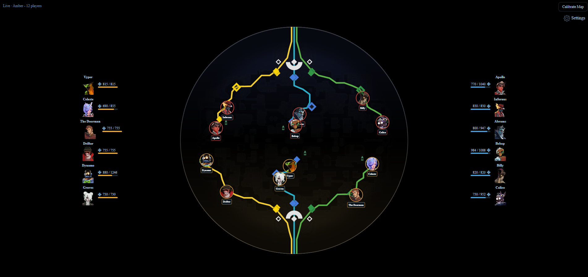

</div>

---

## Table of contents

- [What is WebRadarDL?](#what-is-webradardl)
- [Features](#features)
- [System architecture](#system-architecture)
- [Quick start](#quick-start)
- [How it works](#how-it-works)
- [User interface tour](#user-interface-tour)
- [Sharing](#sharing)
- [Configuration](#configuration)
- [Building from source](#building-from-source)
- [Project layout](#project-layout)
- [Technical documentation](#technical-documentation)
- [Media assets](#media-assets)
- [Troubleshooting](#troubleshooting)

---

## What is WebRadarDL?

WebRadarDL is a **Windows desktop stack** that reads *Deadlock* (`deadlock.exe`) memory from outside the game process, streams normalized player data over WebSockets, and renders a **StatLocker-style live minimap** in a dedicated browser window.

You run **one executable** (`WebRadarDL.exe`). It orchestrates everything else: npm on first launch, the Node.js production server, an elevated memory reader, optional Cloudflare public sharing, and an app-mode browser pointed at `http://localhost:5173`.

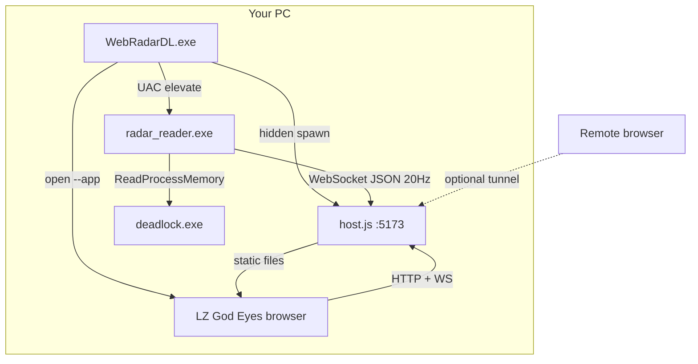

**Design principles**

| Principle | Implementation |
|-----------|----------------|
| Single entry point | `WebRadarDL.exe` / `START.bat` |
| No manual server | `host.js` spawned hidden by launcher |
| Smooth visuals | 20 Hz reader + 60 FPS UI interpolation |
| Share anywhere | LAN + Cloudflare quick tunnel |
| Clean shutdown | Settings → End Program, console close, or `STOP.bat` |

---

## Features

### Live radar

- **Real-time player dots** on a circular Deadlock minimap
- **Hero portraits** and **display names** on side player cards
- **HP bars** with current / max health
- **Team colors** - Amber (`#e8a838`) and Sapphire (`#4a9fd8`)
- **Local player highlight** and team-aware map rotation (Sapphire flips 180°)
- **Position smoothing** - exponential interpolation between 20 Hz packets

### Operations

- **Automatic first-run setup** - `npm install`, optional `npm run build`
- **Windows firewall rule** for LAN viewers (Private profile, TCP 5173)
- **Public share links** via auto-downloaded `cloudflared`
- **Session sync** - calibration and dot size pushed to remote viewers
- **Debug panel** - entity system source, scan mode, controller counts

### Developer-facing

- Full technical docs in [`docs/`](./docs/README.md)
- Committed production build in `webapp/dist/`
- Prebuilt `WebRadarDL.exe` and `radar_reader.exe`
- Documented JSON protocol and offset workflow

---

## System architecture

### Process model

```
WebRadarDL.exe          ← visible console supervisor (you start this)
├── node host.js        ← hidden - HTTP, WebSocket hub, cloudflared
├── radar_reader.exe    ← visible - admin memory reader (UAC)
├── cloudflared.exe       ← hidden - optional public URL
└── Edge/Chrome --app   ← visible - LZ God Eyes UI
```

| Process | Binary | Privilege | Role |
|---------|--------|-----------|------|
| Supervisor | `WebRadarDL.exe` | User | Startup, cleanup, browser launch |
| Web host | `node webapp/host.js` | User | Static UI, WS relay, share API |
| Memory reader | `usermode/release/radar_reader.exe` | **Administrator** | Attach to `deadlock.exe`, emit JSON |
| Tunnel | `tools/cloudflared.exe` | User | `trycloudflare.com` HTTPS relay |
| Browser | Edge / Chrome | User | Renders React from `webapp/dist` |

### Network ports

| Port | Bind | Protocol | Purpose |
|------|------|----------|---------|
| **5173** | `0.0.0.0` | HTTP + WS | Primary UI, `/deadlock_webradar` WebSocket |
| **22006** | `127.0.0.1` | WS (legacy) | Backward-compatible relay |
| **443** outbound | - | HTTPS | cloudflared to Cloudflare edge |

Deep dive: [Architecture](./docs/architecture.md) · [Data protocol](./docs/data-protocol.md)

---

## Quick start

### Requirements

- **Windows 10/11** (x64)
- **[Node.js 18+](https://nodejs.org/)** - used on first run for the web server
- **Deadlock** installed and runnable (`deadlock.exe`)
- **Administrator approval** when UAC prompts for `radar_reader.exe`

To rebuild C++: **Visual Studio 2022** with *Desktop development with C++* (x64).

### Run (prebuilt binaries)

1. Clone this repository
2. Double-click **`WebRadarDL.exe`** or **`START.bat`**

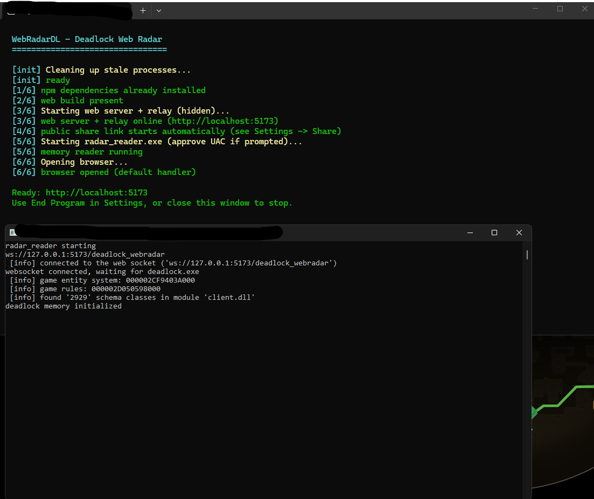

The console runs six steps:

| Step | Action |
|------|--------|
| **1/6** | `npm install` in `webapp/` (if needed) |
| **2/6** | `npm run build` only if `webapp/dist/` is missing |
| **3/6** | Start `host.js` (hidden), wait for port 5173 |
| **4/6** | Log tunnel readiness (tunnel runs inside `host.js`) |
| **5/6** | Launch `radar_reader.exe` - **approve UAC** |

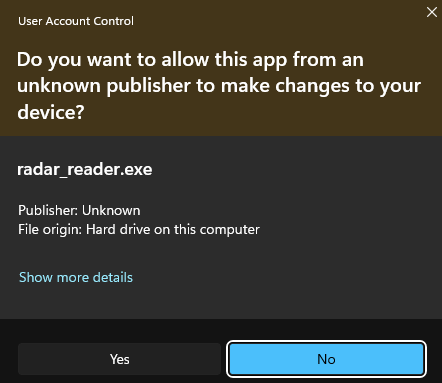

| **6/6** | Open browser app window at `http://localhost:5173` |

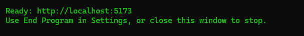

3. Launch **Deadlock** and join a **live match** (not menu-only / spectator-only)

4. Stop via **Settings → Share → End Program**, close the console, or **`STOP.bat`**

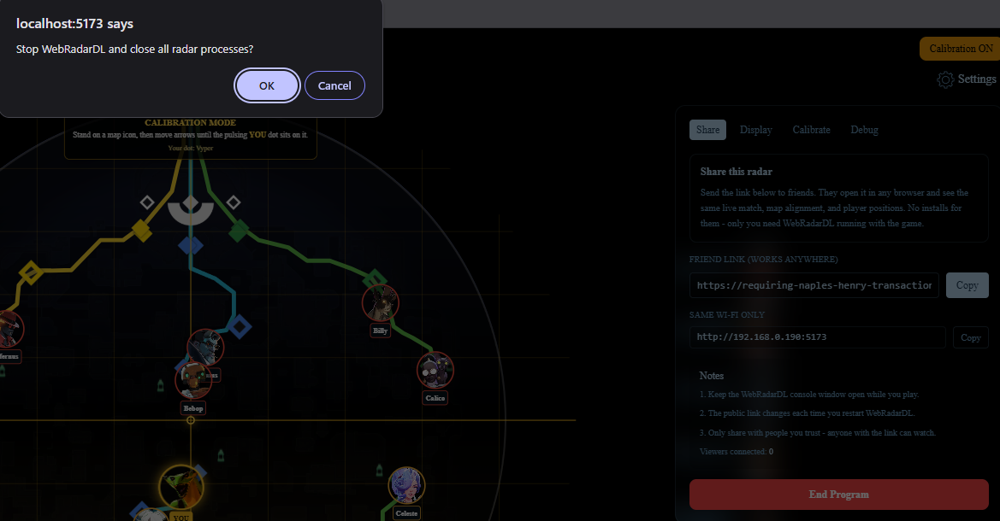

---

## How it works

### Startup sequence

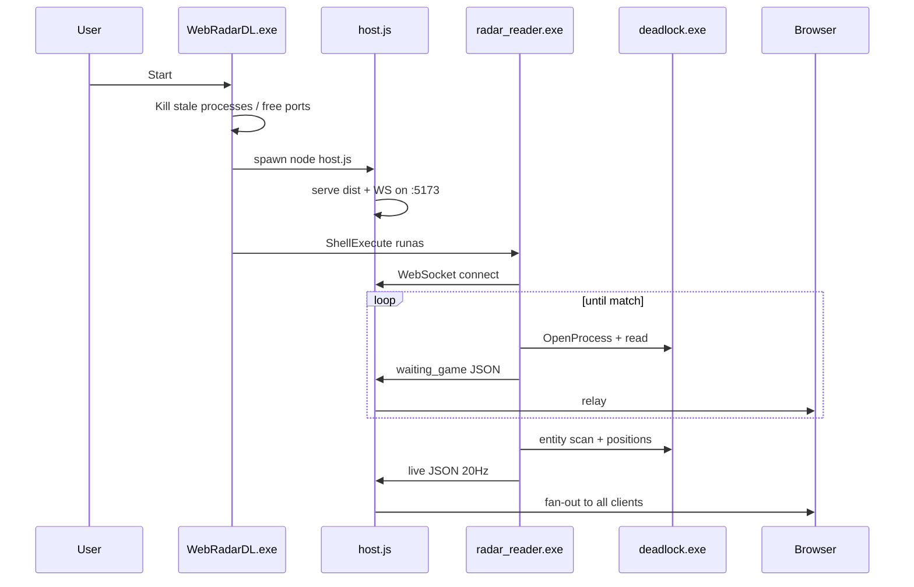

### Memory read loop

The reader sleeps **50 ms** per tick (**20 Hz**):

- Every **4th** tick: **full entity scan** (indices 0–2047, discover controllers)
- Other ticks: **fast refresh** (cached controller list, update positions/HP)

The UI runs `requestAnimationFrame` interpolation (~60 FPS) so dots move smoothly between packets.

### Data flow

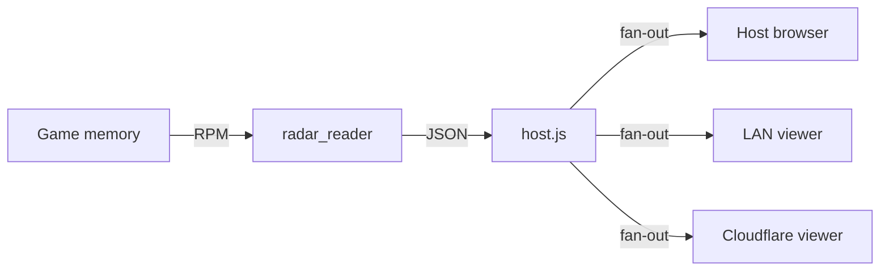

Payload fields include `m_players`, `m_local_team`, `m_minimap_mins` / `m_minimap_maxs`, and `m_debug`. Full schema: [Data protocol](./docs/data-protocol.md).

---

## User interface tour

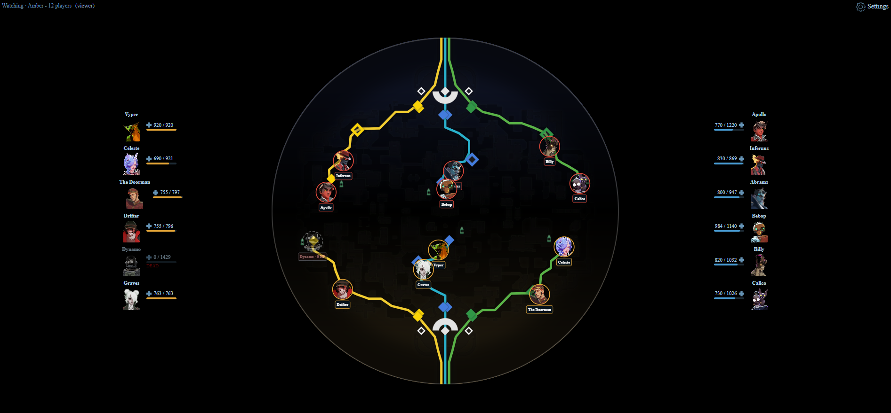

### Live match view

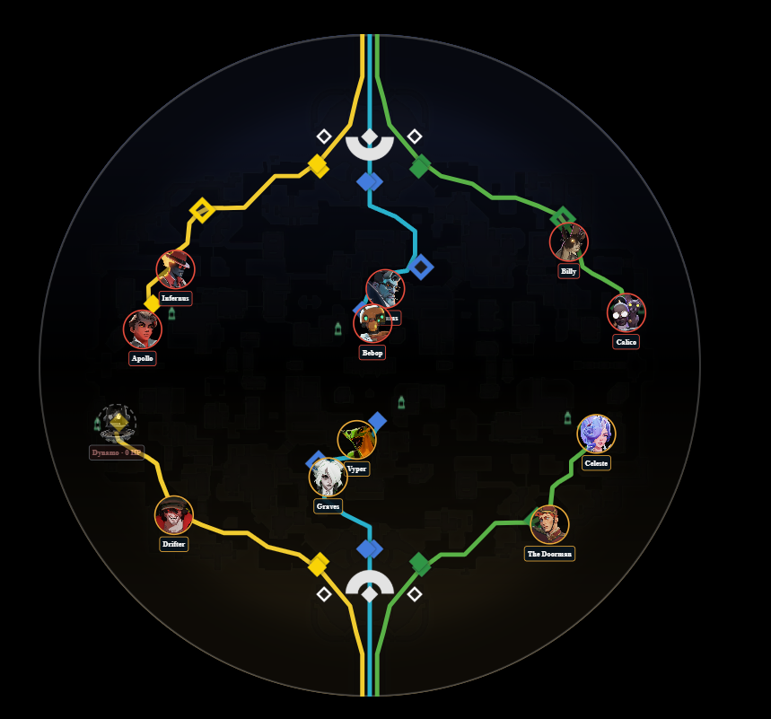

- **Center:** circular minimap with team-colored dots
- **Left / right columns:** player cards with hero art and HP
- **Top:** connection status indicator
- **Bottom-right:** settings gear

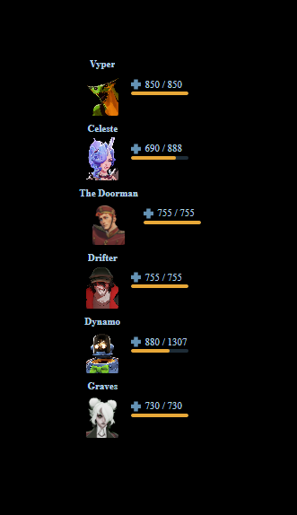

### Settings

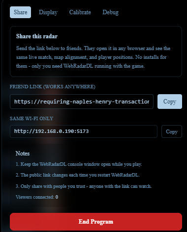

| Tab | Purpose |
|-----|---------|
| **Share** | Copy localhost, LAN, and public URLs; End Program |
| **Calibrate Map** | Offset, scale, zoom, flip - align dots to landmarks |
| **Debug** | Reader diagnostics, entity system, scan mode |

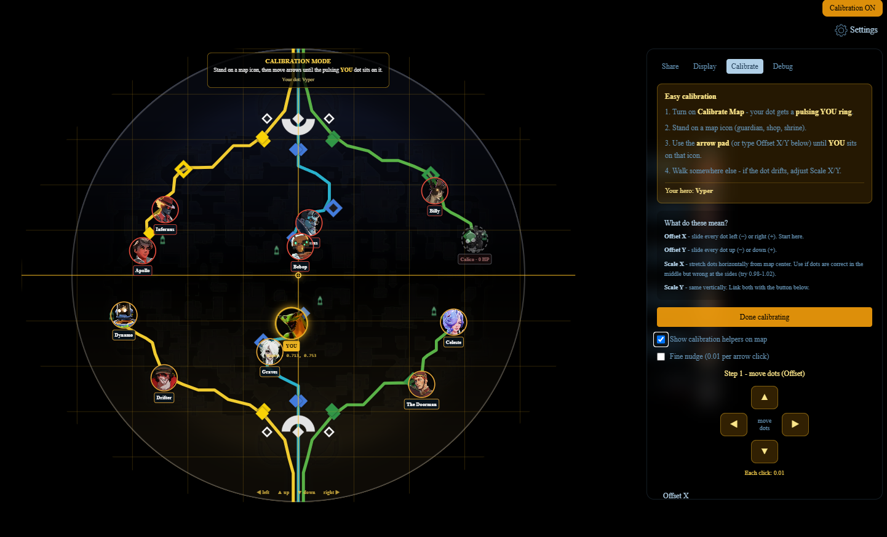

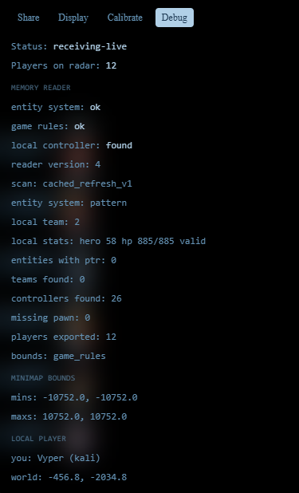

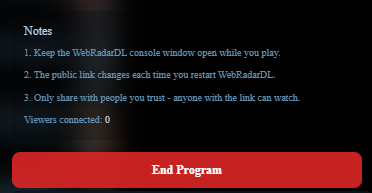

---

## Sharing

Open **Settings → Share** on the host machine.

| Link type | Who can use it | URL example |
|-----------|----------------|-------------|
| **Local** | Same PC | `http://localhost:5173` |
| **LAN** | Devices on your Wi-Fi | `http://192.168.x.x:5173` |
| **Public** | Anyone with the link | `https://random.trycloudflare.com` |

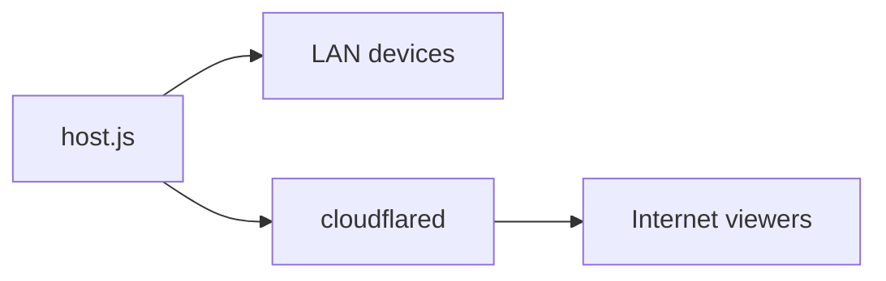

- Viewers need **only a browser** - no game, no reader, no install
- Host syncs **calibration** and **dot size** via WebSocket `session_share`
- Public URLs are **ephemeral** - new each session
- `tunnelStatus`: `idle` → `starting` → `ready` | `failed`

Details: [Sharing & networking](./docs/sharing-and-networking.md)

---

## Configuration

### Memory reader - `usermode/release/config.json`

```json
{
  "m_ip": "127.0.0.1",
  "m_port": 5173
}
```

WebSocket target: `ws://127.0.0.1:5173/deadlock_webradar`

### Browser settings (host only, `localStorage`)

| Key | Storage | Default |
|-----|---------|---------|
| Radar settings | `deadlockRadarSettings` | `{ "dotSize": 1 }` |
| Map calibration | `deadlockMapCalibration` | Merged from `webapp/public/data/deadlock/data.json` |

### Environment variables (optional)

| Variable | Default |
|----------|---------|
| `RADAR_WEB_PORT` | `5173` |
| `RADAR_LEGACY_WS_PORT` | `22006` |

Full reference: [Configuration](./docs/configuration.md) · [Map calibration](./docs/map-calibration.md)

---

## Building from source

### C++ (launcher + reader)

1. Open `usermode/DL_WebRadar.sln` in Visual Studio 2022
2. Configuration: **Release \| x64**
3. Build Solution

| Output | Path |
|--------|------|
| Launcher | `WebRadarDL.exe` |
| Reader | `usermode/release/radar_reader.exe` |

### Web UI

```powershell
cd webapp
npm install
npm run build
```

Skip if you did not change UI - `webapp/dist/` is prebuilt in the repo.

After game patches, update offsets in `usermode/src/sdk/dead_offsets.hpp` and rebuild.

Guide: [Build & release](./docs/build-and-release.md) · [SDK & offsets](./docs/sdk-and-offsets.md)

---

## Project layout

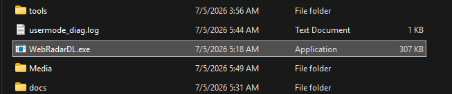

```
WebRadarDL/
├── WebRadarDL.exe              # Launcher supervisor
├── START.bat / STOP.bat        # Start / stop helpers
├── launcher/                   # C++ launcher source
├── usermode/                   # Memory reader source + release/
│   └── release/
│       ├── radar_reader.exe
│       └── config.json
├── webapp/
│   ├── host.js                 # Production Node server
│   ├── dist/                   # Built React app (committed)
│   ├── src/                    # React source
│   └── public/                 # Heroes, maps, data.json
├── tools/                      # cloudflared.exe (runtime download)
├── Media/                      # Screenshots for documentation
└── docs/                       # Full technical documentation
```

Every file explained: [Project structure](./docs/project-structure.md)

---

## Technical documentation

The [`docs/`](./docs/README.md) folder contains hyper-detailed developer documentation for **every subsystem**:

| Document | Topics |
|----------|--------|
| [Architecture](./docs/architecture.md) | Processes, ports, lifecycle, sequences |
| [Project structure](./docs/project-structure.md) | Complete repo map |
| [Launcher supervisor](./docs/launcher-supervisor.md) | `WebRadarDL.exe` internals |
| [Memory reader](./docs/memory-reader.md) | Game attach, scan loop, player export |
| [Web host server](./docs/web-host-server.md) | `host.js`, APIs, cloudflared |
| [Web UI](./docs/web-ui.md) | React components, interpolation |
| [Data protocol](./docs/data-protocol.md) | JSON schemas, WebSocket messages |
| [Sharing & networking](./docs/sharing-and-networking.md) | LAN, tunnel, firewall |
| [Configuration](./docs/configuration.md) | All config layers |
| [Map & calibration](./docs/map-calibration.md) | Coordinate transforms |
| [SDK & offsets](./docs/sdk-and-offsets.md) | Game memory layout |
| [Build & release](./docs/build-and-release.md) | VS, npm, release checklist |
| [Troubleshooting](./docs/troubleshooting.md) | Common failures |

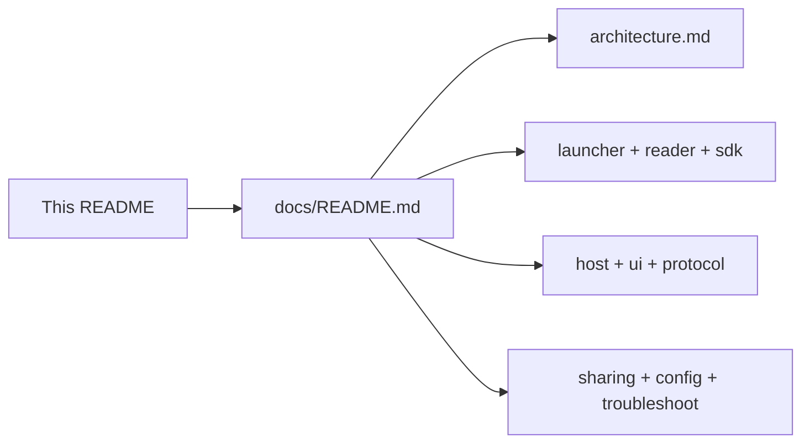

---

## Media assets

Documentation screenshots live in [`Media/`](./Media/). See [`Media/IMAGES.md`](./Media/IMAGES.md) for the full capture guide and filename list.

| File | Description |
|------|-------------|
| `01-hero-banner.png` | Full radar hero shot |
| `02-launcher-init.png` | Console during startup |
| `03-launcher-ready.png` | Ready at localhost:5173 |
| `04-uac-prompt.png` | UAC for radar_reader |
| `05-radar-live-match.png` | Minimap close-up |
| `06-player-cards.png` | Side HP cards |
| `07-settings-share.png` | Share tab |
| `08-settings-calibration.png` | Calibration overlay |
| `09-settings-debug.png` | Debug tab |
| `10-end-program.png` | Shutdown button |
| `11-browser-app-mode.png` | App-mode browser |
| `12-exe-in-explorer.png` | Explorer with EXE |
| `13-share-remote-viewer.png` | Remote viewer |
| `14-stop-bat.png` | STOP.bat |

Optional: `13-share-remote-viewer.png`, `15-visual-studio-build.png`, `16-deadlock-not-running.png`

---

## Troubleshooting

| Symptom | Likely cause | Fix |
|---------|--------------|-----|
| `waiting-usermode` | UAC dismissed / reader not running | Restart; approve UAC |
| `waiting-game` | Deadlock not in match | Launch game; enter match |
| No dots after patch | Stale offsets | Update `dead_offsets.hpp`, rebuild |
| No public URL | Tunnel blocked | Check `.cloudflared.log`, antivirus |
| LAN viewer timeout | Firewall / wrong network | Same Wi-Fi; Private profile |
| Misaligned dots | Calibration drift | Settings → Calibrate Map |

Full guide: [Troubleshooting](./docs/troubleshooting.md)

---

<div align="center">

**WebRadarDL** - external Deadlock radar with shareable browser UI

[Technical docs](./docs/README.md) · [Media guide](./Media/IMAGES.md)

</div>
