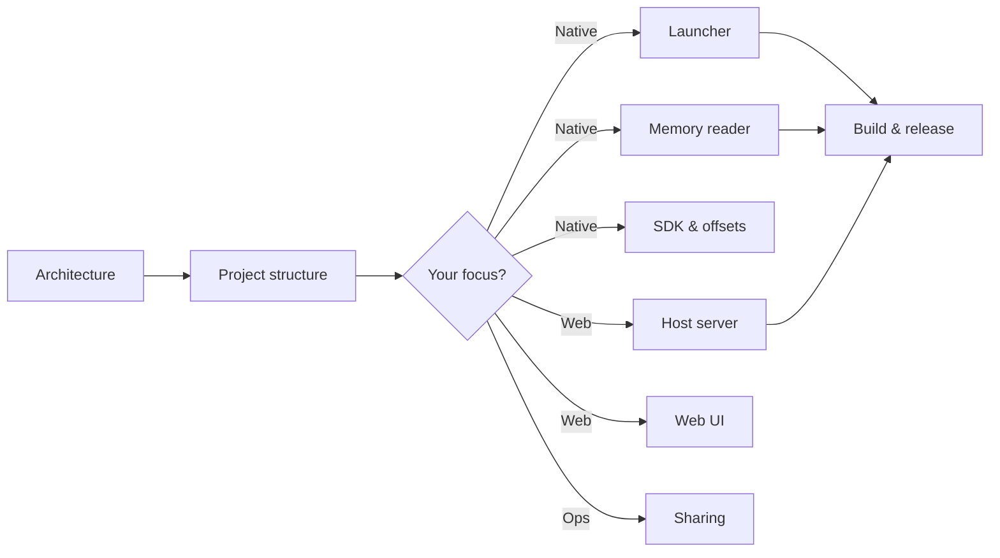

# WebRadarDL — Technical Documentation Index

Hyper-detailed developer documentation for every layer of WebRadarDL. Start with the [main README](../README.md) for the product overview; use this index to dive into a specific subsystem.

---

## Documentation map

| Document | Scope |
|----------|--------|
| [Architecture](./architecture.md) | End-to-end system design, process model, ports, lifecycle |
| [Project structure](./project-structure.md) | Every directory and important file |
| [Launcher supervisor](./launcher-supervisor.md) | `WebRadarDL.exe` / `launcher/main.cpp` |
| [Memory reader](./memory-reader.md) | `radar_reader.exe`, game memory, update loop |
| [Web host server](./web-host-server.md) | `webapp/host.js`, HTTP, WebSocket, cloudflared |
| [Web UI](./web-ui.md) | React app, components, interpolation, rendering |
| [Data protocol](./data-protocol.md) | JSON payloads, WebSocket messages, session sync |
| [Sharing & networking](./sharing-and-networking.md) | LAN, public tunnel, firewall, viewers |
| [Configuration](./configuration.md) | `config.json`, env vars, calibration, settings |
| [Map & calibration](./map-calibration.md) | Minimap assets, bounds, coordinate transform |
| [SDK & offsets](./sdk-and-offsets.md) | `dead_offsets.hpp`, schema, game update workflow |
| [Build & release](./build-and-release.md) | Visual Studio, vcpkg, npm, binaries |
| [Troubleshooting](./troubleshooting.md) | Common failures and diagnostics |

---

## Recommended reading order

---

## Media assets

Screenshots and diagrams for the main README live in [`../Media/`](../Media/). See [`../Media/IMAGES.md`](../Media/IMAGES.md) for capture instructions.
