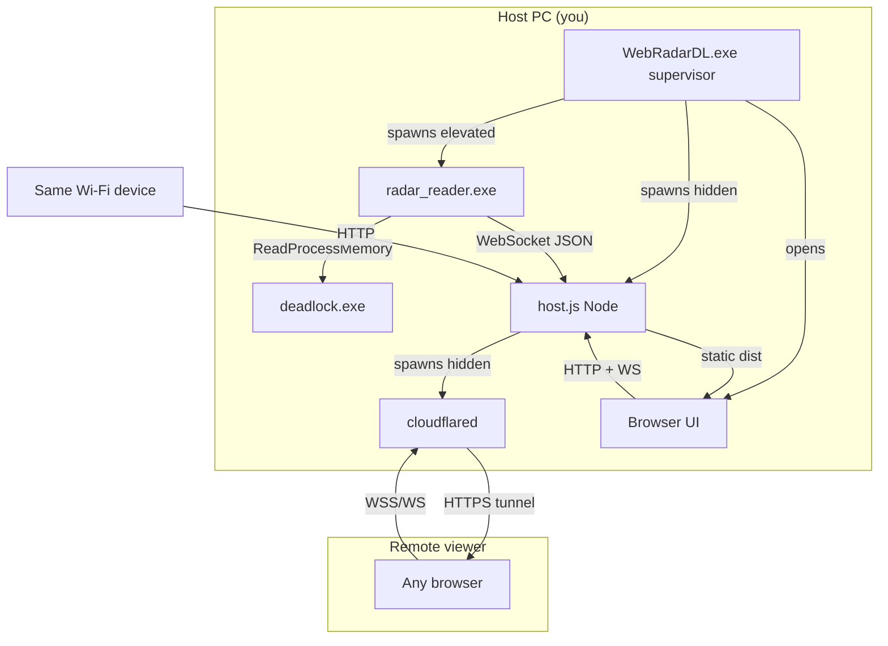
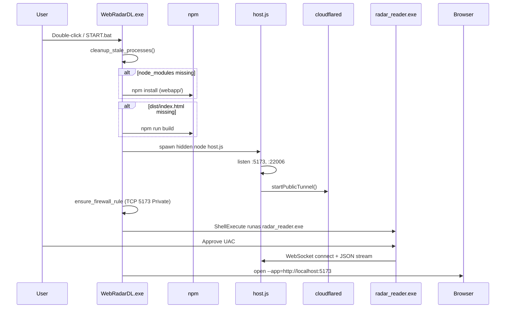
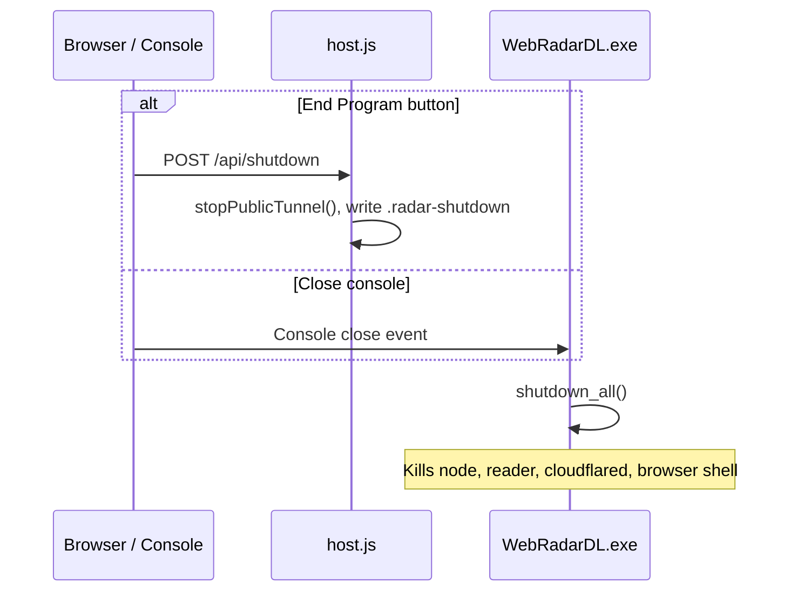
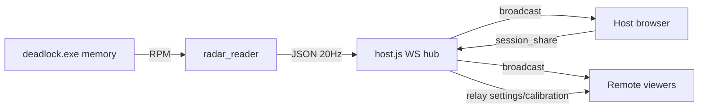

# Architecture

WebRadarDL is a **Windows-native, multi-process live radar** for Valve's game *Deadlock*. It reads player positions and health from the running game process externally, streams that data over WebSockets to a local Node.js host, and renders an interactive browser-based minimap for the host and remote viewers.

---

## System context

---

## Process responsibilities

| Process | Binary / entry | Visibility | Privilege | Primary role |
|---------|----------------|------------|-----------|--------------|
| **Supervisor** | `WebRadarDL.exe` | Visible console | Standard user | Orchestrates startup, shutdown, first-run npm, browser launch |
| **Memory reader** | `usermode/release/radar_reader.exe` | Visible console | **Administrator** (UAC) | Attach to `deadlock.exe`, scan entities, emit JSON at 20 Hz |
| **Web host** | `node webapp/host.js` | Hidden | Standard user | Static UI, WebSocket hub, share API, cloudflared management |
| **Tunnel agent** | `tools/cloudflared.exe` | Hidden | Standard user | Optional `trycloudflare.com` public URL |
| **Browser** | Edge / Chrome `--app` | Visible window | Standard user | Renders React UI from `webapp/dist` |

The supervisor **does not** read game memory. Only `radar_reader.exe` touches `deadlock.exe`.

---

## Network ports

| Port | Protocol | Bind address | Listener | Purpose |
|------|----------|--------------|----------|---------|
| **5173** | HTTP | `0.0.0.0` | `host.js` | Web UI, REST APIs, primary WebSocket `/deadlock_webradar` |
| **22006** | HTTP/WS | `127.0.0.1` | `host.js` (legacy relay) | Secondary WebSocket path for backward compatibility |
| **443** (outbound) | HTTPS | - | cloudflared | Ephemeral public tunnel to Cloudflare edge |

WebSocket path (both servers): **`/deadlock_webradar`**

---

## Startup sequence

---

## Shutdown sequence

Shutdown can be triggered three ways:

1. **Settings → Share → End Program** - UI `POST /api/shutdown` writes `.radar-shutdown`
2. **Close supervisor console** - `CTRL_CLOSE_EVENT` handler
3. **`STOP.bat`** - runs `stop.ps1`, kills processes by name/port

`deadlock.exe` is **never** terminated by WebRadarDL.

---

## Data flow (live match)

---

## Update loop (reader)

`radar_reader.exe` runs a fixed-interval loop:

| Tick | Period | Mode | Work |
|------|--------|------|------|
| Every **50 ms** | 20 Hz | **fast** or **full** | Send WebSocket payload |
| 1 of 4 ticks | 200 ms | **full** | Scan up to 2048 entity slots, rebuild player cache |
| 3 of 4 ticks | 50 ms | **fast** | Refresh cached players' pawn positions/HP only |

See [memory-reader.md](./memory-reader.md) for implementation detail.

---

## Host vs viewer

| Capability | Host (`localhost`) | Viewer (LAN / public URL) |
|------------|-------------------|---------------------------|
| See live radar | Yes | Yes |
| Calibrate map | Yes | No |
| Change display settings | Yes (synced) | Receives host session |
| End Program | Yes | No |
| Share link UI | Yes | No |

Host detection is **client-side**: `window.location.hostname` is `localhost`, `127.0.0.1`, or `::1`.

---

## Runtime files (gitignored)

Created beside the repo root at runtime:

| File | Writer | Purpose |
|------|--------|---------|
| `.radar-shutdown` | `host.js` / UI | Signals supervisor to exit |
| `.radar-public-url.txt` | `host.js` | Cached Cloudflare tunnel URL |
| `.cloudflared.log` | cloudflared | Tunnel stderr log |
| `.radar-session.json` | supervisor | PIDs for optional cleanup |
| `tools/cloudflared.exe` | `host.js` download | Tunnel binary |
| `webapp/node_modules/` | `npm install` | Node dependencies |
| `usermode_diag.log` | reader | Optional diagnostic log |

---

## Technology stack summary

| Layer | Languages / runtime | Key libraries |
|-------|---------------------|---------------|
| Supervisor | C++20 (MSVC) | Win32 API, shell, TCP table |
| Memory reader | C++20 (MSVC) | nlohmann-json, ixwebsocket, vcpkg |
| Web host | Node.js 18+ ESM | `ws`, native `http`, `child_process` |
| Web UI | React 18 + Vite 4 | Tailwind CSS 3 |

---

## Related documents

- [Project structure](./project-structure.md)
- [Launcher supervisor](./launcher-supervisor.md)
- [Memory reader](./memory-reader.md)
- [Web host server](./web-host-server.md)
- [Data protocol](./data-protocol.md)
