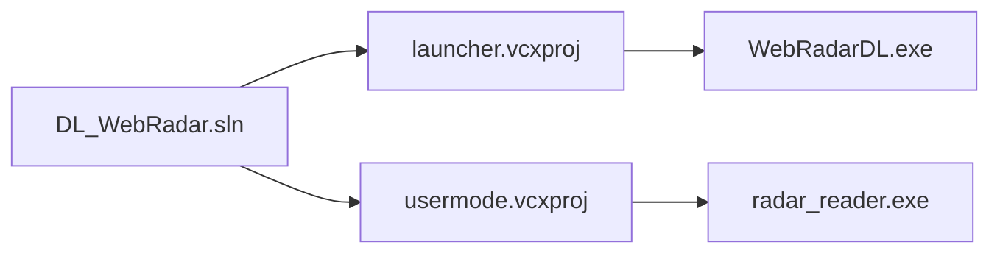
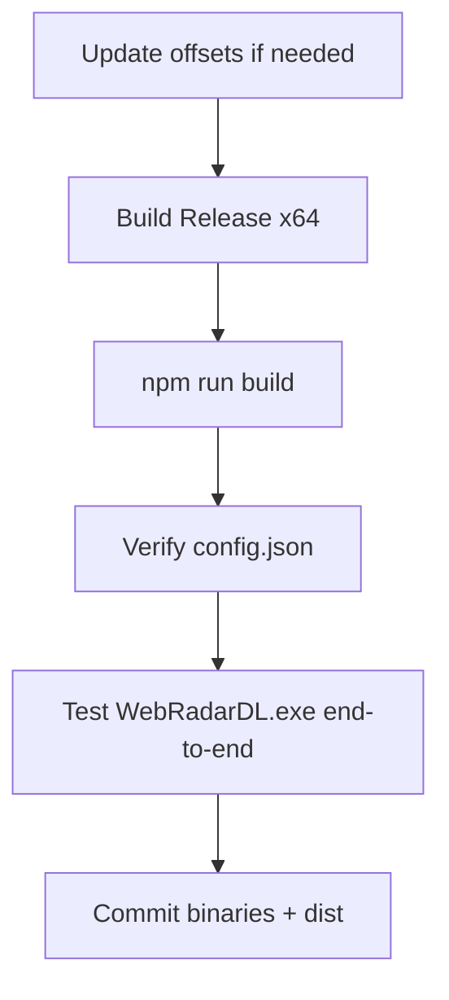

# Build & release

WebRadarDL ships as prebuilt binaries plus a committed `webapp/dist/`. This document covers rebuilding the C++ launcher, memory reader, and React UI from source.

---

## Prerequisites

| Tool | Version | Purpose |
|------|---------|---------|
| Windows | 10/11 x64 | Target OS |
| Visual Studio 2022 | Desktop C++ workload | Build native binaries |
| Node.js | 18+ | Web host + UI build |
| Git | Any | Clone repository |
| vcpkg | Bundled via manifest | C++ dependencies |

---

## Solution layout



**Open:** `usermode/DL_WebRadar.sln`

**Configuration:** `Release | x64`

---

## C++ build steps

1. Open `usermode/DL_WebRadar.sln` in Visual Studio 2022
2. Select **Release** and **x64**
3. Build → Build Solution (Ctrl+Shift+B)

### Outputs

| Project | Output path |
|---------|-------------|
| Launcher | `WebRadarDL.exe` (repository root) |
| Usermode | `usermode/release/radar_reader.exe` |

### vcpkg dependencies

Manifest: `usermode/vcpkg.json`

| Package | Use |
|---------|-----|
| `nlohmann-json` | JSON serialization |
| `ixwebsocket` | WebSocket client |

Restored automatically on first build (static linking, `x64-windows-static`).

### Post-build

Ensure `usermode/release/config.json` exists:

```json
{
  "m_ip": "127.0.0.1",
  "m_port": 5173
}
```

---

## Web UI build

```powershell
cd webapp
npm install
npm run build
```

Output: `webapp/dist/` (HTML, JS, CSS bundles)

The repository **commits** `dist/` so end users can skip this unless the UI changed.

### Dev mode (optional)

```powershell
cd webapp
npm run dev
```

Runs Vite dev server — still needs `host.js` or manual WebSocket for full stack.

---

## Launcher icon

Source: `launcher/WebRadarDL.ico`  
Referenced in `launcher/launcher.vcxproj` for embedded EXE icon.

---

## cloudflared binary

**Not committed** (gitignored). Downloaded at runtime to `tools/cloudflared.exe` by `host.js`.

Manual preload:

```powershell
mkdir tools
Invoke-WebRequest -Uri "https://github.com/cloudflare/cloudflared/releases/latest/download/cloudflared-windows-amd64.exe" -OutFile tools/cloudflared.exe
```

---

## Full release checklist



### Verification matrix

| Test | Expected |
|------|----------|
| First launch | npm install, port 5173 listening |
| UAC | radar_reader elevates |
| No game | UI shows waiting for match |
| In match | Dots + HP update smoothly |
| Share tab | LAN URL + tunnel status |
| End Program | All processes stop |

---

## What gets gitignored

| Pattern | Reason |
|---------|--------|
| `node_modules/` | npm cache |
| `tools/cloudflared.exe` | Downloaded at runtime |
| `*.log`, `.radar-*` | Session files |
| Build intermediates | `release/intermediates/` |

**Committed:** `WebRadarDL.exe`, `radar_reader.exe`, `webapp/dist/`

---

## Related documents

- [Project structure](./project-structure.md)
- [Launcher supervisor](./launcher-supervisor.md)
- [SDK & offsets](./sdk-and-offsets.md)
