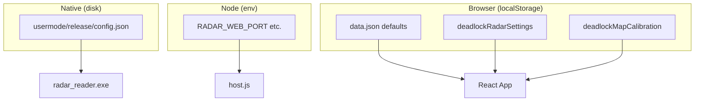

# Configuration

WebRadarDL configuration spans three layers: **C++ reader config**, **Node environment variables**, and **browser-local settings** (calibration + UI preferences).

---

## Configuration layers



---

## Memory reader - `config.json`

**Path:** `usermode/release/config.json` (next to `radar_reader.exe`)

```json
{
  "m_ip": "127.0.0.1",
  "m_port": 5173
}
```

| Key | Type | Default | Description |
|-----|------|---------|-------------|
| `m_ip` | string | `127.0.0.1` | WebSocket server hostname |
| `m_port` | number | `5173` | WebSocket server port |

**Loader:** `usermode/src/utils/config.cpp`

- Missing file → uses defaults
- Missing keys → uses defaults for those keys
- `localhost` normalized to `127.0.0.1`

**WebSocket URL built as:**

```text
ws://{m_ip}:{m_port}/deadlock_webradar
```

### When to change

| Scenario | Change |
|----------|--------|
| Custom port | Set `m_port` to match `RADAR_WEB_PORT` |
| Remote reader (advanced) | Point `m_ip` at host machine IP |

Normally leave at defaults - reader and host run on the same PC.

---

## Node host - environment variables

Set before spawning `host.js` (or in system environment):

| Variable | Default | Effect |
|----------|---------|--------|
| `RADAR_WEB_PORT` | `5173` | Primary HTTP + WebSocket port |
| `RADAR_LEGACY_WS_PORT` | `22006` | Legacy relay bind |

Example:

```powershell
$env:RADAR_WEB_PORT = "8080"
node webapp/host.js
```

If you change the port, update `config.json` `m_port` to match.

---

## Browser - radar settings

**Storage key:** `deadlockRadarSettings`  
**Written by:** host browser only

```json
{
  "dotSize": 1
}
```

| Key | Type | Default | Effect |
|-----|------|---------|-------------|
| `dotSize` | number | `1` | Player dot scale on minimap |

Synced to viewers via `session_share` messages.

---

## Browser - map calibration

**Storage key:** `deadlockMapCalibration`  
**Defaults file:** `webapp/public/data/deadlock/data.json`

```json
{
  "flipX": false,
  "flipY": true,
  "scaleX": 1.25,
  "scaleY": 1.194,
  "offsetX": 0.24,
  "offsetY": 0.14,
  "mapZoom": 0.82,
  "useFixedBounds": false,
  "minX": -8192,
  "minY": -8192,
  "maxX": 8192,
  "maxY": 8192
}
```

| Key | Purpose |
|-----|---------|
| `flipX` / `flipY` | Mirror normalized coordinates |
| `scaleX` / `scaleY` | Stretch around map center |
| `offsetX` / `offsetY` | Translate normalized position |
| `mapZoom` | CSS scale of minimap artwork |
| `useFixedBounds` | Ignore live `m_minimap_*` from game |
| `minX`..`maxY` | Fixed world bounds when enabled |

On first load, host merges `data.json` into calibration state.

See [Map & calibration](./map-calibration.md) for tuning workflow.

---

## Runtime session files (generated)

| File | Writer | Purpose |
|------|--------|---------|
| `.radar-session.json` | Launcher | PIDs for cleanup |
| `.radar-public-url.txt` | host.js | Cached tunnel URL |
| `.radar-shutdown` | host.js | Shutdown signal file |
| `.cloudflared.log` | cloudflared | Tunnel logs |
| `usermode_diag.log` | radar_reader | Reader diagnostics |

These are gitignored and recreated each session.

---

## Batch scripts

| Script | Action |
|--------|--------|
| `START.bat` | Launches `WebRadarDL.exe` |
| `STOP.bat` | Kills radar processes via `stop.ps1` |

---

## Related documents

- [Map & calibration](./map-calibration.md)
- [Memory reader](./memory-reader.md)
- [Web host server](./web-host-server.md)
