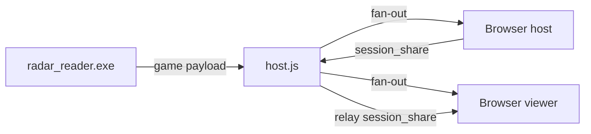

# Data protocol

All real-time data flows as **JSON over WebSocket** on path `/deadlock_webradar`. There is no binary framing, compression, or protobuf - each message is a complete UTF-8 JSON document.

---

## Message types overview



| Message | Direction | Identifier |
|---------|-----------|------------|
| **Game payload** | Reader → all browsers | Contains `m_players` |
| **Session share** | Host browser → viewers | `m_message_type: "session_share"` |
| **Waiting payload** | Reader → all | `m_debug.reader_state` |

---

## Game payload (memory reader)

Emitted at **20 Hz** (50 ms sleep) from `radar_reader.exe`.

### Top-level schema

```json
{
  "m_source": "live",
  "m_local_team": 2,
  "m_minimap_mins": { "x": -8192, "y": -8192, "z": 0 },
  "m_minimap_maxs": { "x": 8192, "y": 8192, "z": 0 },
  "m_players": [ /* PlayerObject[] */ ],
  "m_debug": { /* DebugObject */ }
}
```

| Field | Type | Description |
|-------|------|-------------|
| `m_source` | string | Always `"live"` for reader output |
| `m_local_team` | uint8 | Local player's team enum (see below) |
| `m_minimap_mins` | vec3 | World-space minimap corner from game rules |
| `m_minimap_maxs` | vec3 | Opposite corner |
| `m_players` | array | All discovered controllers this tick |
| `m_debug` | object | Diagnostics (host Debug tab) |

### Team enum

| Value | Name |
|-------|------|
| `0` | none |
| `1` | spectator |
| `2` | amber |
| `3` | sapphire |

### Player object

```json
{
  "m_idx": 42,
  "m_name": "Haze",
  "m_team": 2,
  "m_health": 850,
  "m_health_max": 850,
  "m_hero_id": 15,
  "m_hero_slug": "haze",
  "m_position": { "x": 1234.5, "y": -567.8, "z": 128.0 },
  "m_eye_angle": 90.0,
  "m_is_local": false,
  "m_is_dead": false,
  "m_has_pawn": true
}
```

| Field | Notes |
|-------|-------|
| `m_idx` | Entity index in Source 2 entity system |
| `m_name` | Display name (hero name preferred in UI) |
| `m_hero_slug` | Lowercase slug for `hero_map.json` lookup |
| `m_position` | Pawn world origin (`m_vecAbsOrigin`) |
| `m_eye_angle` | Yaw in degrees (not rendered in current UI) |
| `m_has_pawn` | `false` when dead / pawn despawned |

### Debug object (representative keys)

| Key | When present | Meaning |
|-----|--------------|---------|
| `reader_state` | Waiting for game | `"waiting_game"` |
| `reader_detail` | Waiting | Human-readable reason |
| `update_mode` | Live | `"full"` or `"fast"` |
| `entity_system_ok` | Live | Entity list resolved |
| `entity_system_source` | Live | `"pattern"` or `"rva"` |
| `controllers_found` | Full scan | Raw controller count |
| `players_exported` | Full scan | Players sent to UI |
| `bounds_source` | Live | `"game_rules"` or `"fallback"` |
| `local_hero_id` | Live | Local hero numeric ID |
| `scan_error` | Error path | e.g. `"no entity system"` |

### Waiting-for-game payload

Sent every 2 seconds until `deadlock.exe` is attached and initialized:

```json
{
  "m_source": "live",
  "m_local_team": 0,
  "m_players": [],
  "m_minimap_mins": { "x": -8192, "y": -8192, "z": 0 },
  "m_minimap_maxs": { "x": 8192, "y": 8192, "z": 0 },
  "m_debug": {
    "reader_state": "waiting_game",
    "reader_detail": "deadlock.exe not found",
    "entity_system_ok": false,
    "game_rules_ok": false,
    "local_controller_found": false
  }
}
```

---

## Session share message (browser)

Sent by the **host** browser on connect and when calibration/settings change:

```json
{
  "m_message_type": "session_share",
  "m_calibration": { /* CalibrationObject */ },
  "m_settings": { "dotSize": 1 }
}
```

`host.js` stores the latest `sharedSession` and:

1. Relays to other connected browsers
2. Sends to new viewers on connect

Viewers merge `m_calibration` and `m_settings` into local React state (no `localStorage` write).

---

## WebSocket URL construction

```javascript
const protocol = window.location.protocol === "https:" ? "wss:" : "ws:";
const url = `${protocol}//${window.location.host}/deadlock_webradar`;
```

Reader uses config-driven URL:

```text
ws://127.0.0.1:5173/deadlock_webradar
```

---

## Host relay semantics

`host.js` on each `message`:

1. Parse JSON
2. If `m_message_type === "session_share"` → update `sharedSession`, relay to others
3. If body contains `"m_source"` → mark sender as `readerClient`
4. Store as `lastGamePayload`
5. Broadcast raw string to **every** connected client

Late joiners receive `lastGamePayload` immediately on `connection`.

---

## Update cadence

```mermaid
gantt
  title Reader tick pattern (50ms per tick)
  dateFormat X
  axisFormat %L ms

  section Ticks
  full scan     :0, 50
  fast          :50, 50
  fast          :100, 50
  fast          :150, 50
  full scan     :200, 50
```



- **Full scan** (`f::run`): every 4th tick - entity iteration 0..2047
- **Fast scan** (`f::run_fast`): cached controller list refresh

---

## Related documents

- [Memory reader](./memory-reader.md)
- [Web host server](./web-host-server.md)
- [Web UI](./web-ui.md)
