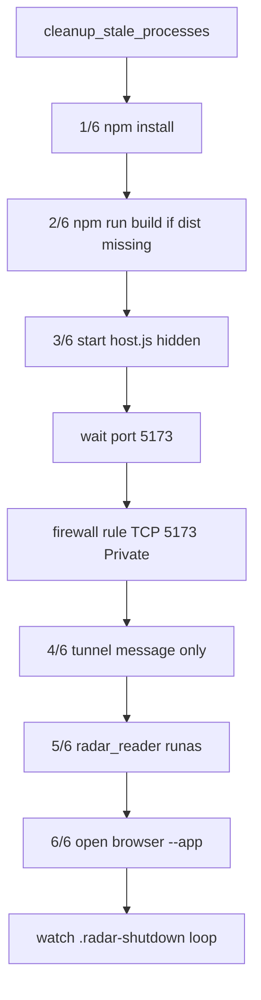

# Launcher supervisor (`WebRadarDL.exe`)

Source: `launcher/main.cpp`  
Output: `WebRadarDL.exe` (repository root)

The launcher is the **only process the user starts intentionally**. It owns the visible initialization console, spawns all child processes, and blocks until shutdown.

---

## Initialization pipeline

The supervisor runs **six numbered steps** plus a pre-clean phase:



| Step | Function | Failure behavior |
|------|----------|------------------|
| **init** | `cleanup_stale_processes()` | Kills stale node/cloudflared/reader, frees ports 5173/22006 |
| **1/6** | `ensure_npm_dependencies()` | Exits if `npm install` fails |
| **2/6** | `ensure_web_build()` | Skips if `webapp/dist/index.html` exists; else `npm run build` |
| **3/6** | `start_host_server()` | Hidden `node host.js`; waits up to 60s for port 5173 |
| **4/6** | `start_public_tunnel()` | **Log only** - tunnel is managed inside `host.js` |
| **5/6** | `start_memory_reader()` | `ShellExecuteExW` with `runas`; does not fail if UAC delayed |
| **6/6** | `open_browser()` | Tries Edge/Chrome `--app=`, falls back to default handler |

---

## Child process spawning

### Hidden Node host

```text
cmd.exe /c node host.js
Working directory: <repo>/webapp
Window: SW_HIDE
PID stored: g_session.host_node_pid
```

### Elevated memory reader

```text
Verb: runas (UAC)
File: usermode/release/radar_reader.exe
Working directory: usermode/release
Window: SW_SHOW
```

### Browser app window

Tries, in order:

1. `msedge.exe --app=http://localhost:5173 --new-window`
2. `chrome.exe --app=...`
3. `ShellExecuteW` default handler

---

## Stale process cleanup

`cleanup_stale_processes()` runs **before** startup:

- `kill_processes_by_name`: `cloudflared.exe`, `radar_reader.exe`, `usermode.exe`
- `stop_port_listeners`: kills owning PID for TCP **5173**, **5174**, **22006**
- Deletes: `.radar-shutdown`, `.radar-public-url.txt`, `.cloudflared.log`, `.radar-session.json`

---

## Firewall

Adds inbound rule **`WebRadarDL (TCP 5173)`** for **Private** profile via `netsh` (silent). Required for LAN sharing on Windows.

---

## Shutdown (`shutdown_all`)

Triggered when:

- `.radar-shutdown` file appears (from UI **End Program**)
- User closes console (`CTRL_CLOSE_EVENT`, etc.)

Actions:

1. Kill browser shell PID (if tracked)
2. Kill host node process tree
3. Kill reader process tree
4. `kill_processes_by_name(cloudflared.exe)`
5. Free ports 5173 / 22006
6. Delete runtime session files

---

## Session file

Writes `.radar-session.json`:

```json
{
  "hostNodePid": 12345,
  "tunnelPid": 0,
  "browserPid": 67890,
  "readerPid": 11111
}
```

`stop.ps1` can read this for targeted cleanup.

---

## Console UI

| Helper | Color | Usage |
|--------|-------|-------|
| `print_ok` | Green | Step success |
| `print_warn` | Yellow | In progress / non-fatal |
| `print_fail` | Red | Fatal step failure |

Banner text: `WebRadarDL - Deadlock Web Radar`

---

## Related documents

- [Architecture](./architecture.md)
- [Web host server](./web-host-server.md)
- [Build & release](./build-and-release.md)
