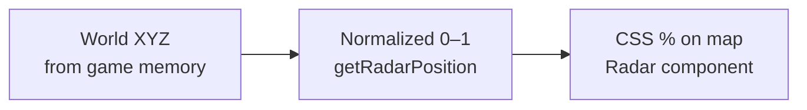
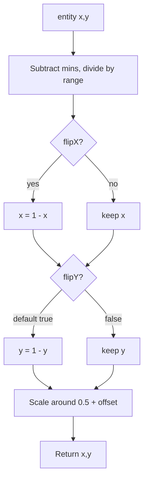

# Map & calibration

WebRadarDL overlays live player positions on a **StatLocker-style Deadlock minimap**. World coordinates from the game must be transformed into normalized 0–1 space, then mapped to CSS percentages on the circular radar.

---

## Coordinate systems



| Space | Source | Example |
|-------|--------|---------|
| **World** | `m_position.x/y` from reader | `1234.5, -567.8` |
| **Bounds** | `m_minimap_mins` / `m_minimap_maxs` from game rules | `-8192` .. `8192` |
| **Normalized** | After bounds + calibration | `0.0` .. `1.0` |
| **Screen** | Percent inside map container | `left: 45%` |

---

## Bounds sources

### Live game rules (default)

`f::get_bounds()` reads `C_CitadelGameRules`:

- `m_vMinimapMins` → `m_minimap_mins`
- `m_vMinimapMaxs` → `m_minimap_maxs`

`m_debug.bounds_source` = `"game_rules"`

### Fallback

When game rules unavailable:

```json
"m_minimap_mins": { "x": 0, "y": 0, "z": 0 },
"m_minimap_maxs": { "x": 1, "y": 1, "z": 0 }
```

### Fixed bounds mode

Enable **useFixedBounds** in calibration to ignore live bounds and use:

```json
"minX": -8192, "minY": -8192,
"maxX": 8192, "maxY": 8192
```

Useful when game-reported bounds drift or for manual override.

---

## Transform algorithm

Implementation: `getRadarPosition()` in `webapp/src/utilities/utilities.js`



Formula:

```text
x = (entity.x - mins.x) / (maxs.x - mins.x)
y = (entity.y - mins.y) / (maxs.y - mins.y)

if flipX: x = 1 - x
if flipY: y = 1 - y

x = (x - 0.5) * scaleX + 0.5 + offsetX
y = (y - 0.5) * scaleY + 0.5 + offsetY
```

---

## Team-based map rotation

Separate from calibration — applied in `Radar.jsx`:

| Local team | Map rotation |
|------------|--------------|
| Amber (2) | 0° |
| Sapphire (3) | **180°** |

Reason: StatLocker artwork has Amber base at bottom; Sapphire players need a flip to match in-game minimap orientation.

---

## Default calibration

Shipped in `webapp/public/data/deadlock/data.json`:

| Parameter | Default | Typical use |
|-----------|---------|-------------|
| `scaleX` | `1.25` | Horizontal stretch |
| `scaleY` | `1.194` | Vertical stretch |
| `offsetX` | `0.24` | Shift dots right |
| `offsetY` | `0.14` | Shift dots down |
| `mapZoom` | `0.82` | Shrink background art |
| `flipY` | `true` | Match Source Y axis |

---

## Interactive calibration UI

**Settings → Calibrate Map**

| Control | Adjusts |
|---------|---------|
| Scale sliders | `scaleX`, `scaleY` |
| Offset sliders | `offsetX`, `offsetY` |
| Map zoom | `mapZoom` |
| Flip toggles | `flipX`, `flipY` |
| Nudge pad | ±0.01 on offsets per click |
| Fixed bounds toggle | `useFixedBounds` + min/max fields |

### Calibrate mode

Enables overlay with pulsing **YOU** marker at local player position. Stand on a known lane landmark and nudge until dots align.

### Export

**Copy calibration JSON** produces a snippet suitable for `data.json` — share calibrated values across machines by committing to repo or distributing file.

---

## Map artwork assets

| Path | Description |
|------|-------------|
| `webapp/public/maps/deadlock/` | Minimap PNG layers |
| `webapp/src/data/deadlock/map-definition.json` | Layer metadata |
| `webapp/src/components/statlockermap.jsx` | Renders masked circular map |

`mapZoom` applies CSS `transform: scale()` to the artwork layer independently of dot positions.

---

## Persistence

| Storage | Scope |
|---------|-------|
| `localStorage.deadlockMapCalibration` | Host browser |
| `session_share` WebSocket | Synced to viewers live |
| `data.json` | Repository default for fresh installs |

---

## Tuning workflow

1. Start WebRadarDL and join a **custom lobby** or practice mode
2. Stand on a visible lane marker or shrine
3. Open **Calibrate Map** → enable calibration mode
4. Adjust offset nudge pad until **YOU** dot sits on the landmark
5. Walk to opposite lane — verify scale; tweak `scaleX`/`scaleY` if needed
6. Export JSON and optionally update `data.json` for distribution

---

## Related documents

- [Web UI](./web-ui.md)
- [Configuration](./configuration.md)
- [Data protocol](./data-protocol.md)
