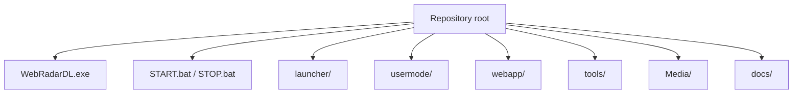

# Project structure

Complete map of the WebRadarDL repository. Paths are relative to the repository root.

---

## Top-level layout

---

## Root files

| Path | Type | Description |
|------|------|-------------|
| `WebRadarDL.exe` | Prebuilt binary | Release build of `launcher/` - primary entry point for users |
| `START.bat` | Script | `cd` to repo root and run `WebRadarDL.exe` |
| `STOP.bat` | Script | Invokes `stop.ps1` to kill all radar processes |
| `stop.ps1` | PowerShell | Process/port cleanup without touching `deadlock.exe` |
| `README.md` | Docs | Product overview and quick start |
| `.gitignore` | Git | Ignores `node_modules`, build artifacts, runtime session files |

---

## `launcher/` - C++ supervisor

| Path | Description |
|------|-------------|
| `main.cpp` | Full supervisor logic: npm, build check, spawn host/reader/browser, shutdown |
| `launcher.vcxproj` | MSVC project; output `../WebRadarDL.exe` |
| `WebRadarDL.ico` | Application icon (from favicon) |

**Build output:** `WebRadarDL.exe` at repository root.

---

## `usermode/` - C++ memory reader

| Path | Description |
|------|-------------|
| `DL_WebRadar.sln` | Visual Studio solution (usermode + launcher projects) |
| `usermode.vcxproj` | Reader project; output `release/radar_reader.exe` |
| `vcpkg.json` | Manifest: `nlohmann-json`, `ixwebsocket` |
| `release/config.json` | WebSocket target IP/port for reader |
| `release/radar_reader.exe` | Prebuilt reader binary |

### `usermode/src/`

| Directory / file | Responsibility |
|------------------|----------------|
| `dllmain.cpp` | `main()`: config, WebSocket loop, game init retry, tick loop |
| `common.hpp` | Logging macros, game DLL names, pattern signatures |
| `pch.hpp` / `pch.cpp` | Precompiled header |
| `core/interfaces.cpp` | Resolve schema system, entity system, game rules |
| `core/schema.cpp` | Runtime Source 2 schema offset table (optional fallback) |
| `core/sdk.cpp` | Local controller pointer update |
| `features/features.cpp` | Player scan (full + fast), bounds, JSON assembly |
| `features/players/players.cpp` | Per-player JSON fields (HP, position, hero) |
| `sdk/dead_offsets.hpp` | **Generated offsets** - refresh dump + `generate_offsets.ps1` after patches |
| `sdk/entity.hpp` | Entity/controller/pawn wrappers |
| `sdk/player_stats.hpp` | `PlayerDataGlobal` health/hero validation |
| `sdk/hero_ids.hpp` | Hero ID → slug map |
| `utils/memory.cpp` | `OpenProcess`, `ReadProcessMemory`, pattern scan |
| `utils/config.cpp` | Load `config.json` beside exe |

---

## `webapp/` - Node host + React UI

| Path | Description |
|------|-------------|
| `host.js` | **Production server**: static files, WebSocket hub, APIs, cloudflared |
| `package.json` | npm scripts: `build`, `host` |
| `index.html` | Dev entry; title **LZ God Eyes** |
| `vite.config.js` | Vite build config |
| `dist/` | **Committed production build** served by `host.js` |
| `public/` | Static assets copied into `dist/` on build |
| `src/` | React source |

### `webapp/src/components/`

| Component | Role |
|-----------|------|
| `app.jsx` | Root state, WebSocket client, connection status |
| `radar.jsx` | Map container, player dot layer |
| `player.jsx` | Single hero dot on map |
| `playercard.jsx` | Side panel HP + portrait |
| `statlockermap.jsx` | Layered minimap renderer |
| `settings.jsx` | Settings panel (share, display, performance, calibrate, debug) |
| `heroportrait.jsx` | Hero image with fallback |
| `maskedicon.jsx` | SVG mask icons |

### `webapp/src/hooks/`

| Hook | Role |
|------|------|
| `useInterpolatedPlayers.js` | 60 FPS position smoothing between 20 Hz packets |

### `webapp/public/`

| Path | Role |
|------|------|
| `favicon.png` | Tab icon |
| `heroes/*.png` | Hero portrait cards |
| `heroes/hero_map.json` | Display name → filename slug |
| `data/deadlock/data.json` | Default calibration constants |
| `data/deadlock/map/layers/` | Minimap PNG layers |
| `data/deadlock/map/icons/` | Objective icons on map |

---

## `dumper/`

| Path | Role |
|------|------|
| `dezlock-dump.exe` / `dezlock-worker.dll` | Schema dumper for Deadlock |
| `schema-dump/deadlock/client.txt` | Class field map (codegen input) |
| `schema-dump/deadlock/_globals.txt` | Module RVAs / singletons (codegen input) |

Bulk dump folders (`hierarchy/`, `sdk/`, etc.) are gitignored - only the two codegen inputs above are required.

---

## `tools/`

| Path | Role |
|------|------|
| `.gitkeep` | Ensures folder exists in git |
| `generate_offsets.ps1` | Runs offset codegen against the dump |
| `offset-codegen/` | Python bridge + `fields.json` allowlist |
| `cloudflared.exe` | Downloaded at runtime (gitignored) |

---

## `Media/`

Screenshots referenced by README and docs. See [`Media/IMAGES.md`](../Media/IMAGES.md).

---

## `docs/`

Technical documentation (this folder).

---

## What is intentionally not in the repo

| Item | Reason |
|------|--------|
| `webapp/node_modules/` | Restored via `npm install` on first run |
| `usermode/vcpkg_installed/` | Restored by MSVC/vcpkg on build |
| `**/intermediates/`, `*.pdb` | Build artifacts |
| `dumper/schema-dump/...` bulk | Huge SDK trees - keep `client.txt` + `_globals.txt` only |
| Runtime session files | Ephemeral per session |

---

## Related documents

- [Architecture](./architecture.md)
- [Build & release](./build-and-release.md)
- [SDK & offsets](./sdk-and-offsets.md)
