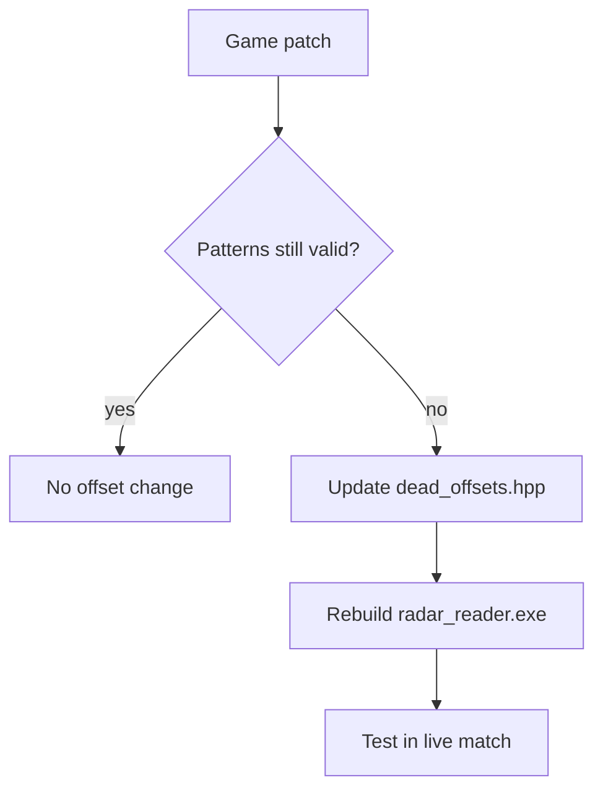
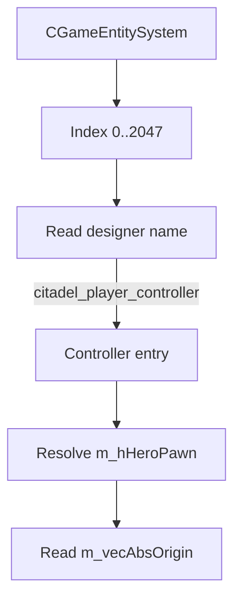

# SDK & offsets

The memory reader targets **Valve Source 2** structures inside `deadlock.exe`. Offsets are maintained in `usermode/src/sdk/dead_offsets.hpp` and supplemented by pattern scanning and optional schema dumps.

---

## Offset maintenance model



After most Deadlock updates, **`dead_offsets.hpp` must be refreshed** from a current dump (e.g. dezlock, cs2-dumper style tools for Source 2).

---

## Primary offset file

**Path:** `usermode/src/sdk/dead_offsets.hpp`

### Entity & scene graph

| Symbol | Offset | Class |
|--------|--------|-------|
| `m_pEntity` | `0x10` | `CEntityInstance` |
| `m_identityHandle` | `0x10` | `CEntityIdentity` |
| `m_designerName` | `0x20` | `CEntityIdentity` |
| `m_pGameSceneNode` | `0x330` | `C_BaseEntity` |
| `m_iHealth` | `0x354` | `C_BaseEntity` |
| `m_iTeamNum` | `0x3F3` | `C_BaseEntity` |
| `m_vecAbsOrigin` | `0xC8` | `CGameSceneNode` |
| `m_bDormant` | `0x103` | `CGameSceneNode` |

### Player controller

| Symbol | Offset | Class |
|--------|--------|-------|
| `m_iszPlayerName` | `0x6F0` | `CBasePlayerController` |
| `m_steamID` | `0x778` | `CBasePlayerController` |
| `m_bIsLocalPlayerController` | `0x780` | `CBasePlayerController` |
| `m_hHeroPawn` | `0x8AC` | `CCitadelPlayerController` |
| `m_PlayerDataGlobal` | `0x8F0` | `CCitadelPlayerController` |

### PlayerDataGlobal_t (relative to `m_PlayerDataGlobal`)

| Symbol | Offset |
|--------|--------|
| `pdg_m_iHealthMax` | `0x10` |
| `pdg_m_nHeroID` | `0x1C` |
| `pdg_m_iHealth` | `0x4C` |
| `pdg_m_bAlive` | `0x68` |

### Pawn & team

| Symbol | Offset | Class |
|--------|--------|-------|
| `m_angEyeAngles` | `0x11B8` | `C_CitadelPlayerPawn` |
| `m_aPlayerControllers` | `0x5F0` | `C_CitadelTeam` |
| `m_aPlayers` | `0x608` | `C_CitadelTeam` |

### Game rules & globals (RVA in `client.dll`)

| Symbol | RVA | Purpose |
|--------|-----|---------|
| `rva_game_entity_system` | `0x30820D0` | Entity list fallback |
| `rva_local_controller` | `0x2DCA358` | Local player controller |
| `rva_game_rules` | `0x3792FD0` | Minimap bounds |
| `m_vMinimapMins` | `0x84` | Relative to game rules |
| `m_vMinimapMaxs` | `0x90` | Relative to game rules |

*RVA values are version-specific - update after patches.*

---

## Pattern scanning

Defined in `usermode/src/common.hpp`:

| Macro | Module | Resolves |
|-------|--------|----------|
| `GET_SCHEMA_SYSTEM` | `schemasystem.dll` | Schema interface |
| `GET_ENTITY_LIST` | `client.dll` | `CGameEntitySystem*` |

**Resolution order** (`interfaces.cpp`):

1. Try pattern `GET_ENTITY_LIST` → `entity_system_source = "pattern"`
2. Fallback RVA `rva_game_entity_system` → `entity_system_source = "rva"`

Debug tab shows which path succeeded.

---

## Entity system usage



Handle mask constants (`ENT_ENTRY_MASK`, etc.) follow Source 2 entity handle layout.

---

## Schema system

`schema::setup()` optionally loads runtime schema tables for dynamic offset resolution.

**Current radar behavior:** primarily uses **hardcoded offsets** from `dead_offsets.hpp`. Schema failure logs a warning and continues:

```text
schema dump unavailable - using hardcoded offsets
```

---

## Hero ID → slug mapping

`usermode/src/sdk/player_stats.cpp` (and related) maps numeric hero IDs to slugs consumed by the UI (`hero_map.json`).

If a new hero ships:

1. Add ID mapping in native code
2. Add portrait + entry in `webapp/public/heroes/`

---

## Game update checklist

1. Launch updated Deadlock - note build ID / date
2. Run offset dumper against `client.dll`
3. Update `dead_offsets.hpp` RVAs and struct offsets
4. Verify patterns in `common.hpp` still match
5. Rebuild **Release | x64**
6. Test: entity scan, HP, positions, minimap bounds
7. Commit offset file with patch date comment

---

## Related documents

- [Memory reader](./memory-reader.md)
- [Build & release](./build-and-release.md)
- [Troubleshooting](./troubleshooting.md)
