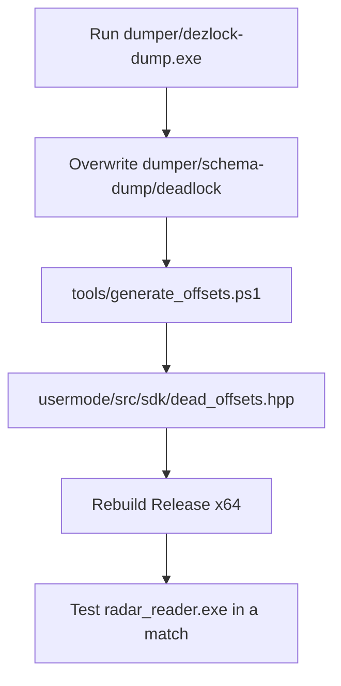

# SDK & offsets

The memory reader targets **Valve Source 2** structures inside `deadlock.exe`. Field offsets and module RVAs live in `usermode/src/sdk/dead_offsets.hpp`, which is **auto-generated** from a dezlock schema dump.

---

## Offset update workflow (post-patch)



### Steps

1. Run **`dumper/dezlock-dump.exe`** against the updated game.
2. Ensure output lands in (or replace) **`dumper/schema-dump/deadlock/`** with at least:
   - `client.txt`
   - `_globals.txt`
3. Generate offsets:

```powershell
.\tools\generate_offsets.ps1
```

Or build `usermode` in Visual Studio - PreBuild runs the same script when the dump is present.

4. Rebuild **Release | x64** (`radar_reader.exe`).
5. Smoke-test in a live match.

You do **not** hand-edit `dead_offsets.hpp`. Edit `tools/offset-codegen/fields.json` only if the radar needs a new field.

---

## Codegen bridge

| Path | Role |
|------|------|
| `tools/offset-codegen/generate_offsets.py` | Parses dump, writes header |
| `tools/offset-codegen/fields.json` | Allowlist of fields + globals |
| `tools/generate_offsets.ps1` | Convenience wrapper |
| `dumper/schema-dump/deadlock/client.txt` | `Class.field = 0xNNN` map |
| `dumper/schema-dump/deadlock/_globals.txt` | Module RVAs / singletons |
| `usermode/src/sdk/dead_offsets.hpp` | Generated output (`dl_off::`) |

```powershell
# Resolve only (no write)
.\tools\generate_offsets.ps1 -Check

# Custom dump path
.\tools\generate_offsets.ps1 -Dump "D:\dumps\deadlock"
```

---

## What the generator pulls

### Struct fields (from `client.txt`)

| Symbol | Class.field |
|--------|-------------|
| `m_pEntity` | `CEntityInstance.m_pEntity` |
| `m_pGameSceneNode` | `C_BaseEntity.m_pGameSceneNode` |
| `m_iHealth` | `C_BaseEntity.m_iHealth` |
| `m_iTeamNum` | `C_BaseEntity.m_iTeamNum` |
| `m_vecAbsOrigin` | `CGameSceneNode.m_vecAbsOrigin` |
| `m_bDormant` | `CGameSceneNode.m_bDormant` |
| `m_iszPlayerName` | `CBasePlayerController.m_iszPlayerName` |
| `m_steamID` | `CBasePlayerController.m_steamID` |
| `m_bIsLocalPlayerController` | `CBasePlayerController.m_bIsLocalPlayerController` |
| `m_hHeroPawn` | `CCitadelPlayerController.m_hHeroPawn` |
| `m_PlayerDataGlobal` | `CCitadelPlayerController.m_PlayerDataGlobal` |
| `pdg_m_iHealthMax` | `PlayerDataGlobal_t.m_iHealthMax` |
| `pdg_m_nHeroID` | `PlayerDataGlobal_t.m_nHeroID` |
| `pdg_m_iHealth` | `PlayerDataGlobal_t.m_iHealth` |
| `pdg_m_bAlive` | `PlayerDataGlobal_t.m_bAlive` |
| `m_angEyeAngles` | `C_CitadelPlayerPawn.m_angEyeAngles` |
| `m_aPlayerControllers` | `C_Team.m_aPlayerControllers` |
| `m_aPlayers` | `C_Team.m_aPlayers` |
| `m_vMinimapMins` | `C_CitadelGameRules.m_vMinimapMins` |
| `m_vMinimapMaxs` | `C_CitadelGameRules.m_vMinimapMaxs` |

`m_identityHandle` / `m_designerName` use stable Source 2 defaults when missing from schema.

### Module RVAs (from `_globals.txt`)

| Symbol | Source |
|--------|--------|
| `rva_game_entity_system` | `client.dll::CGameEntitySystem` |
| `rva_local_controller` | `# CCitadelPlayerController @ client.dll+...` |
| `rva_game_rules` | `# C_CitadelGameRules @ client.dll+...` |

---

## Patterns (not codegen)

Byte signatures in `usermode/src/common.hpp` (`GET_ENTITY_LIST`, `GET_SCHEMA_SYSTEM`) are still scanned at runtime. Entity list prefers the pattern; RVAs are fallbacks. If a patch breaks pattern scan, retune signatures manually.

Optional runtime schema (`schema::setup`) can still load live tables from `schemasystem.dll`, but the radar's production path uses the generated hardcoded offsets.

---

## Hero IDs

Hero ID → slug mapping is **not** part of the schema dump. Update:

- `usermode/src/sdk/hero_ids.hpp`
- `webapp/src/data/hero-id-map.json`
- `webapp/public/heroes/hero_map.json`

only when new heroes ship.

---

## Build

1. Open `usermode/DL_WebRadar.sln`
2. **Release | x64**
3. Build - PreBuild regenerates offsets when the dump folder exists

Outputs: `usermode/release/radar_reader.exe`
