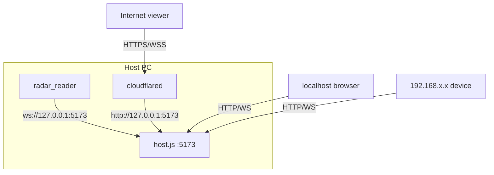
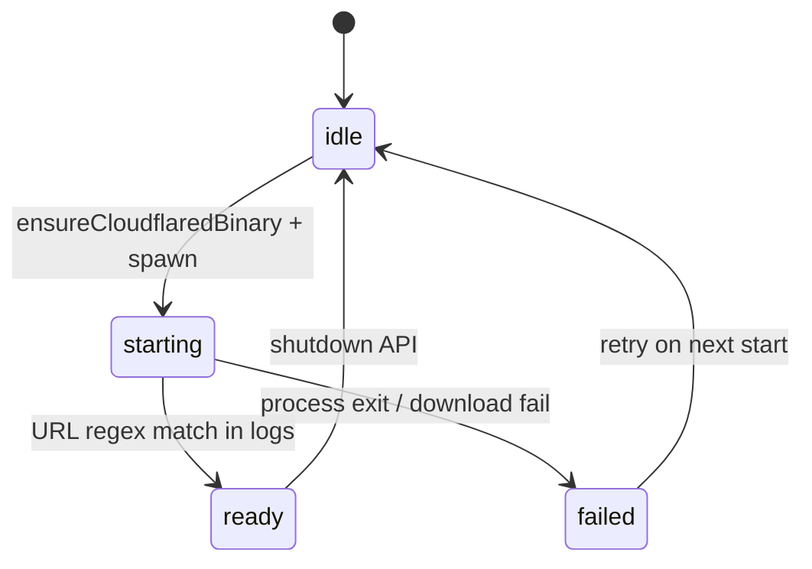

# Sharing & networking

WebRadarDL supports three viewing paths: **localhost**, **LAN**, and **public internet** (via Cloudflare quick tunnel). All paths terminate at the same `host.js` instance on the host PC.

---

## Network topology



---

## Access methods

| Method | URL pattern | Requirements |
|--------|-------------|--------------|
| **Local** | `http://localhost:5173` | Same machine as WebRadarDL |
| **LAN** | `http://<host-lan-ip>:5173` | Same network; Windows firewall Private rule |
| **Public** | `https://<random>.trycloudflare.com` | cloudflared running; outbound HTTPS |

The UI **Share** tab lists all available URLs via `GET /api/radar/share-info`.

---

## Share info API

### Request

```http
GET /api/radar/share-info HTTP/1.1
Host: localhost:5173
```

### Response fields

| Field | Type | Description |
|-------|------|-------------|
| `localUrl` | string | `http://localhost:5173` |
| `publicUrl` | string \| null | Cloudflare URL when ready |
| `tunnelStatus` | string | `idle`, `starting`, `ready`, `failed` |
| `tunnelError` | string \| null | Error message if failed |
| `viewerUrls` | string[] | LAN IPs on port 5173 |
| `webPort` | number | Default 5173 |
| `hasLiveData` | boolean | `lastGamePayload` exists |
| `readerConnected` | boolean | Reader WebSocket active |
| `viewerCount` | number | Non-localhost, non-reader clients |

Polled every **2 seconds** by the host UI.

---

## Cloudflare quick tunnel

Managed entirely inside `host.js` (not the C++ launcher).

### Lifecycle



### Binary location

`tools/cloudflared.exe` - auto-downloaded from GitHub releases if missing.

### Log files

| File | Content |
|------|---------|
| `.cloudflared.log` | cloudflared stderr/stdout |
| `.radar-public-url.txt` | Cached public URL string |

### URL detection

Regex: `https://[a-z0-9-]+\.trycloudflare.com`

Poll interval: **1 second** until matched.

---

## Windows firewall

The launcher adds an inbound rule on startup:

```text
netsh advfirewall firewall add rule name="WebRadarDL (TCP 5173)" dir=in action=allow protocol=TCP localport=5173 profile=private
```

This allows **Private** network profile devices to reach port 5173. Public profile is not opened by default.

---

## Viewer experience

Remote viewers:

1. Open share URL in any modern browser
2. Connect WebSocket to same host (`wss://` when using Cloudflare)
3. Receive `lastGamePayload` snapshot on connect
4. Receive `session_share` for calibration sync
5. See interpolated radar - **no game or reader required**

Viewer count excludes:

- Connections from `127.0.0.1` / `::1`
- The memory reader WebSocket

---

## Legacy port 22006

`host.js` also listens on `127.0.0.1:22006` with path `/deadlock_webradar` for backward compatibility. The memory reader and UI use **5173** by default.

Override with environment variables:

| Variable | Default |
|----------|---------|
| `RADAR_WEB_PORT` | `5173` |
| `RADAR_LEGACY_WS_PORT` | `22006` |

---

## Security considerations

| Topic | Behavior |
|-------|----------|
| Authentication | None - anyone with the URL can view |
| Shutdown API | `POST /api/shutdown` restricted to localhost |
| Tunnel URL | Ephemeral; changes each session |
| Game memory | Never exposed over network - only derived positions |

Treat public share links as **temporary read-only access** to your radar feed.

---

## Related documents

- [Web host server](./web-host-server.md)
- [Launcher supervisor](./launcher-supervisor.md)
- [Troubleshooting](./troubleshooting.md)
