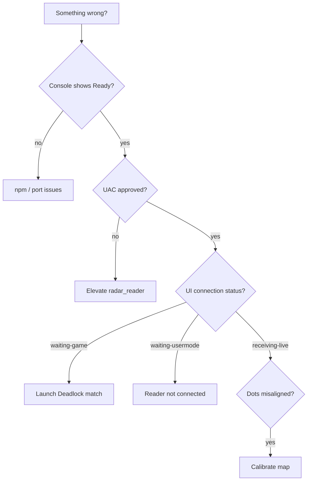

# Troubleshooting

Symptoms, causes, and fixes for common WebRadarDL failures. Check the launcher console, `usermode_diag.log`, and the in-app **Debug** tab first.

---

## Diagnostic map

---

## Startup failures

### npm install fails (step 1/6)

| Symptom | Console error during `npm install` |
|---------|-------------------------------------|
| Cause | Node.js missing, network blocked, corrupt `node_modules` |
| Fix | Install [Node.js 18+](https://nodejs.org/); delete `webapp/node_modules` and retry |

### Port 5173 already in use (step 3/6)

| Symptom | `failed to start host` or port timeout |
|---------|----------------------------------------|
| Cause | Previous session or another app on 5173 |
| Fix | Run `STOP.bat` or reboot; launcher also kills port listeners on startup |

### `dist/index.html` missing

| Symptom | host.js exits immediately |
|---------|---------------------------|
| Cause | `webapp/dist/` deleted without rebuild |
| Fix | `cd webapp && npm install && npm run build` |

---

## Memory reader issues

### UAC prompt dismissed

| Symptom | UI stuck on `waiting-usermode` |
|---------|--------------------------------|
| Cause | `radar_reader.exe` not elevated |
| Fix | Restart WebRadarDL; click **Yes** on UAC |

### `waiting-game` forever

| Symptom | Debug shows `reader_state: waiting_game` |
|---------|------------------------------------------|
| Cause | Deadlock not running or not in a match |
| Fix | Launch Deadlock; enter a real match (not main menu only) |

### No players on map

| Symptom | Connected but empty `m_players` |
|---------|-----------------------------------|
| Cause | Offsets outdated after game patch |
| Fix | Update `dead_offsets.hpp`, rebuild — see [SDK & offsets](./sdk-and-offsets.md) |

### `entity_system_ok: false`

| Symptom | Debug tab shows entity system failed |
|---------|--------------------------------------|
| Cause | Pattern + RVA both invalid post-patch |
| Fix | Update `rva_game_entity_system` and patterns |

---

## WebSocket / UI issues

### `disconnected` loop

| Symptom | Status flickers disconnected |
|---------|------------------------------|
| Cause | host.js crashed or firewall blocking |
| Fix | Check console; restart; verify port 5173 |

### Choppy dot movement

| Symptom | Dots jump every 50ms |
|---------|----------------------|
| Expected | Reader is 20 Hz |
| Fix | Interpolation should smooth — verify `useInterpolatedPlayers` enabled; if still bad, check CPU load |

### Remote viewer sees stale data

| Symptom | Viewer frozen |
|---------|---------------|
| Cause | Host closed reader but browser still open |
| Fix | Viewer only gets relay while host session runs |

---

## Sharing issues

### No public URL / `tunnelStatus: failed`

| Symptom | Share tab shows failed tunnel |
|---------|-------------------------------|
| Cause | cloudflared download blocked, antivirus, no outbound HTTPS |
| Fix | Allow `tools/cloudflared.exe`; check `.cloudflared.log` |

### `tunnelStatus: starting` stuck

| Symptom | Starting for >60s |
|---------|-------------------|
| Cause | Cloudflare edge delay or log parse miss |
| Fix | Read `.cloudflared.log` for URL; restart session |

### LAN viewer cannot connect

| Symptom | Timeout from phone/other PC |
|---------|------------------------------|
| Cause | Different subnet, Public firewall profile |
| Fix | Same Wi-Fi; set network to Private; verify firewall rule added |

---

## Map alignment

### Dots consistently offset

| Fix | Open **Calibrate Map** → nudge offsets |
|-----|----------------------------------------|

### Dots scale wrong across map

| Fix | Adjust `scaleX` / `scaleY` |
|-----|------------------------------|

### Sapphire team upside-down

| Expected | 180° rotation is intentional |
|----------|-------------------------------|
| Fix | If still wrong, toggle `flipY` in calibration |

---

## Shutdown issues

### Processes survive after close

| Fix | Run `STOP.bat` or `stop.ps1` |
|-----|------------------------------|

### End Program does nothing

| Cause | Not on localhost |
|-------|------------------|
| Fix | Only host can call `/api/shutdown` |

---

## Log file reference

| File | Location | Contents |
|------|----------|----------|
| `usermode_diag.log` | Repo root or cwd | Reader attach, WS connect |
| `.cloudflared.log` | Repo root | Tunnel URL, errors |
| Launcher console | Visible window | Step-by-step init |
| Browser DevTools | F12 → Console | WS parse errors |

---

## Clean reinstall procedure

1. Run `STOP.bat`
2. Delete `webapp/node_modules` (optional)
3. Delete session files: `.radar-*`, `*.log`
4. Pull latest repo
5. Rebuild if developing from source
6. Launch `WebRadarDL.exe`

---

## Related documents

- [Configuration](./configuration.md)
- [Sharing & networking](./sharing-and-networking.md)
- [SDK & offsets](./sdk-and-offsets.md)
