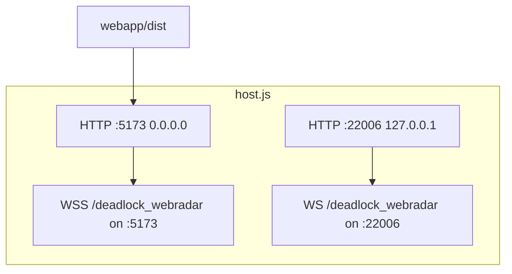
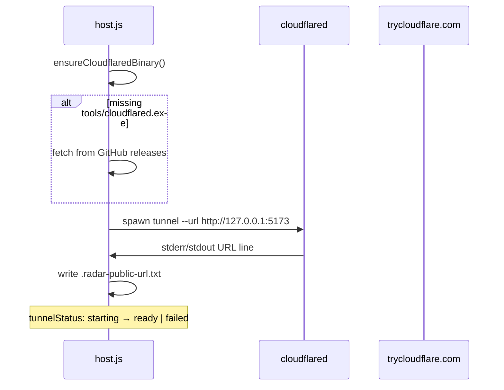

# Web host server (`host.js`)

Source: `webapp/host.js`  
Runtime: **Node.js 18+** (ES modules)

`host.js` is the production backend. It serves the built React UI, multiplexes WebSocket traffic between the memory reader and browsers, exposes control APIs, and manages the optional Cloudflare quick tunnel.

---

## Servers created



| Server | Bind | Path | Role |
|--------|------|------|------|
| Primary | `0.0.0.0:5173` | `/` | Static UI + APIs + main WebSocket |
| Legacy | `127.0.0.1:22006` | `/deadlock_webradar` | Compatibility relay |

---

## HTTP routes

| Method | Path | Access | Response |
|--------|------|--------|----------|
| `GET` | `/*` | All | Static file from `webapp/dist/` |
| `GET` | `/api/radar/share-info` | All | JSON share metadata |
| `POST` | `/api/shutdown` | **Localhost only** | `{ ok: true }` + writes `.radar-shutdown` |

### `GET /api/radar/share-info`

```json
{
  "localUrl": "http://localhost:5173",
  "publicUrl": "https://xxxx.trycloudflare.com",
  "tunnelStatus": "ready",
  "tunnelError": null,
  "viewerUrls": ["http://192.168.x.x:5173"],
  "webPort": 5173,
  "hasLiveData": true,
  "readerConnected": true,
  "viewerCount": 0
}
```

Polled by the UI every **2 seconds** on the host.

---

## WebSocket hub behavior

On each `message`:

1. Parse JSON; if `m_message_type === "session_share"` → update `sharedSession`, relay to other browsers
2. If payload contains `"m_source"` → treat sender as **memory reader** (`readerClient`)
3. Store `lastGamePayload` for late-joining viewers
4. **Fan-out** raw message to every connected WebSocket client

On `connection`:

- Send `lastGamePayload` (if any) to new browser clients
- Send `sharedSession` calibration/settings snapshot

### Client counting

`viewerCount` excludes localhost and the reader connection — used for share metadata.

---

## Static file serving

- Root: `webapp/dist/`
- MIME map for `.js`, `.css`, `.png`, `.woff2`, etc.
- SPA fallback: unknown GET → `index.html`

Startup **exits** if `dist/` is missing.

---

## Cloudflare quick tunnel



| State | Meaning |
|-------|---------|
| `idle` | Not started |
| `starting` | Process running, URL not parsed yet |
| `ready` | Public URL available |
| `failed` | Download error or cloudflared exit |

Polls logs every **1s** until URL found. Regex: `https://[a-z0-9-]+.trycloudflare.com`

On shutdown API: `stopPublicTunnel()` kills child process.

---

## Environment variables

| Variable | Default | Effect |
|----------|---------|--------|
| `RADAR_WEB_PORT` | `5173` | HTTP/WS primary port |
| `RADAR_LEGACY_WS_PORT` | `22006` | Legacy relay port |

---

## Related documents

- [Sharing & networking](./sharing-and-networking.md)
- [Data protocol](./data-protocol.md)
- [Web UI](./web-ui.md)
