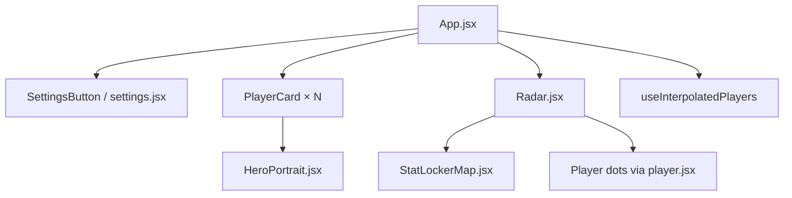
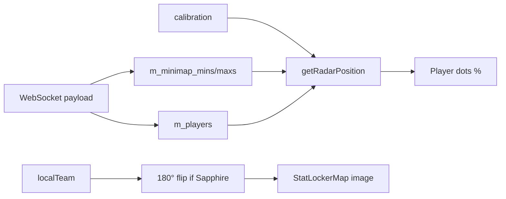

# Web UI (React)

Source: `webapp/src/`  
Build output: `webapp/dist/`  
Browser tab title: **LZ God Eyes**

The web UI is a **Vite + React 18** single-page application that connects to `host.js` over WebSocket, renders a StatLocker-style minimap with hero portraits, and exposes settings for sharing, calibration, and shutdown.

---

## Technology stack

| Layer | Technology |
|-------|------------|
| Bundler | Vite |
| UI framework | React 18 |
| Styling | Tailwind CSS + custom `App.css` |
| State | React hooks (`useState`, `useEffect`, `useRef`) |
| Persistence | `localStorage` (host only) |

---

## Component tree



| File | Responsibility |
|------|----------------|
| `app.jsx` | WebSocket lifecycle, state, layout, host/viewer mode |
| `components/radar.jsx` | Circular map container, team rotation, dot rendering |
| `components/statlockermap.jsx` | Background minimap image + mask |
| `components/playercard.jsx` | Side column hero card with HP bar |
| `components/player.jsx` | Map dot (team color, local highlight) |
| `components/heroportrait.jsx` | Hero image with fallback |
| `components/settings.jsx` | Modal: Share, Calibrate, Debug, End Program |
| `hooks/useInterpolatedPlayers.js` | 60 FPS position interpolation |
| `utilities/utilities.js` | Teams, calibration math, hero lookup |

---

## Host vs viewer mode

Determined by `isRadarHost()` in `utilities.js`:

```javascript
host === "localhost" || host === "127.0.0.1" || host === "[::1]"
```

| Capability | Host | Remote viewer |
|------------|------|---------------|
| Persist settings/calibration | Yes (`localStorage`) | Receives via `session_share` |
| Poll `/api/radar/share-info` | Yes (2s interval) | No |
| Send calibration sync | Yes | No |
| End Program | Yes | No |
| See live radar | Yes | Yes (relay only) |

Remote viewers connect via LAN IP or Cloudflare URL - same WebSocket path, no memory reader on their machine.

---

## Connection states

| Status string | Meaning |
|---------------|---------|
| `connecting` | WebSocket opening |
| `connected` | Open, awaiting first game payload |
| `waiting-usermode` | No data after 4s (reader not connected) |
| `waiting-game` | Reader connected, `reader_state: waiting_game` |
| `receiving-live` | Live payloads with `m_source: live` |
| `receiving` | Data without live marker |
| `watching-waiting` | Viewer waiting for host data |
| `watching-live` | Viewer receiving live relay |
| `disconnected` | Socket closed; auto-reconnect in 3s |
| `error` | WebSocket error |

---

## Position interpolation

`useInterpolatedPlayers` runs a `requestAnimationFrame` loop:

| Constant | Value | Effect |
|----------|-------|--------|
| `SMOOTHING_MS` | 85 | Exponential smoothing time constant |
| `STALE_SNAP_MS` | 280 | Snap to target if no packets |
| `TELEPORT_UNITS` | 4500 | Instant jump (respawn/teleport) |

Reader sends at **20 Hz**; UI displays at **~60 FPS** with lerped positions.

---

## Map rendering pipeline



### Team rotation

StatLocker art places Amber (team 2) at the bottom. When `localTeam === sapphire (3)`, the map rotates **180°** so your base stays at the bottom - matching in-game minimap behavior.

### Dot sizing

`settings.dotSize` (default `1`) scales player marker radius on the map.

---

## Static assets loaded at runtime

| Path | Purpose |
|------|---------|
| `./heroes/hero_map.json` | Slug → portrait filename + display name |
| `./heroes/*.png` | Hero portrait images |
| `./data/deadlock/data.json` | Default calibration values |
| `./maps/deadlock/*.png` | Minimap artwork (via StatLockerMap) |

---

## Settings modal tabs

### Share

- Displays `localUrl`, `publicUrl`, `viewerUrls` from `/api/radar/share-info`
- Copy buttons for each link
- `tunnelStatus`: `idle` | `starting` | `ready` | `failed`
- **End Program** → `POST /api/shutdown`

### Display

- Hero icon size (`dotSize`)
- **Reload Map** (host) - clear caches and force a full entity scan

### Performance (host)

- Performance mode toggle
- Update Hz, full-scan interval, low-priority / skip-unchanged options
- Sends `reader_control` / `set_performance` over the WebSocket

### Calibrate

- Sliders: `scaleX`, `scaleY`, `offsetX`, `offsetY` (map zoom is fixed at `0.82`)
- Toggles: `flipX`, `flipY`, `useFixedBounds`
- Nudge pad for fine offset adjustment
- Export JSON snippet for `data.json`
- **Calibrate mode** overlay with pulsing **YOU** marker

### Debug

- Reader diagnostics from `m_debug` payload
- Entity system source, update mode, controller counts

---

## Related documents

- [Data protocol](./data-protocol.md)
- [Map & calibration](./map-calibration.md)
- [Sharing & networking](./sharing-and-networking.md)
